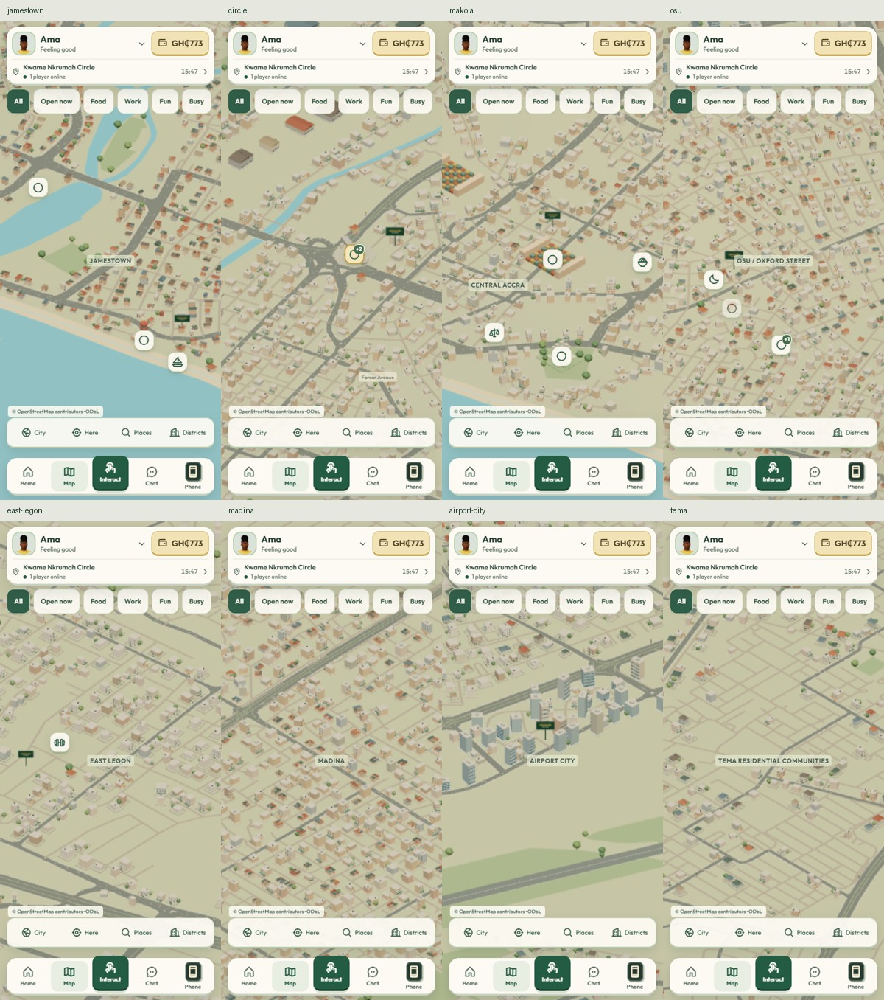

# Phase 3 — Greater Accra city map

Implementation date: 15 October 2026. This milestone changes the city-map
presentation, navigation and rendering. Phase 1 onboarding, Phase 2 HUD, room
interactions, avatars and server-controlled gameplay remain in place. No public
deployment or Phase 4 work is included.

## 1. Original map findings

The [pre-change audit and complete catalogue inventory](city-map-audit.md) were
recorded before editing map code. The old city repeated 915 four-corner plots,
used ten schematic roads and a five-point shore, and stopped around central
Accra/East Legon. Fixed camera limits excluded the metropolitan outskirts.
Buildings were merged into large geometry buffers without a city LOD system.
Markers overlapped, labels competed, and billboard refresh discarded objects
without disposing their resources.

Original map geometry occupied 93,369,726 bytes. The captured overview rendered
741,511 triangles in 58 draw calls. Source geometry ownership and billboard
texture lifetimes were audited alongside `world.js`, `neighbourhood.js`, room
builders, `bake.js`, `stage.js`, the HUD and travel entry points.

## 2. Existing destination compatibility

All **55 destination IDs** and **eight home IDs** are preserved, including all
16 neighbourhood/estate entry points. All original saved x/z coordinates remain
unchanged on the server. See the audit's two inventory tables and the committed
`client/test/fixtures/city-catalog.json` compatibility fixture.

The game's 39 ordinary venues, eight streets, eight estates and the player's own
home remain selectable through the map and searchable Places directory. Map
filters still work. Other homes' decorative miniatures do not grant access to
their private interiors. Property ownership, rents, advance payments, transport
options, fare formulas, rush-hour rules and journey times are unchanged.

Existing land-investment areas (Kasoa, Adenta, Oyarifa, Prampram, East Legon Hills
and East Legon) have geographic scenery. Their investment mechanics remain in
the existing phone/game systems; they are not new travel destinations.

## 3. Coverage and boundary

The final presentation rectangle is **5.50–5.79 N, 0.46 W–0.15 E**. It includes
Kasoa's metropolitan corridor, western Accra, central/coastal Accra, northern
suburbs through Oyarifa, the Accra–Tema connection, Tema's residential and
industrial areas, and Prampram. It intentionally excludes Aburi, Nsawam, Old
Ningo and the rest of Ghana. This is a justified game extent, not an assertion
about administrative Greater Accra boundaries.

The audit initially considered a larger northern/eastern rectangle. The final
boundary removes distant areas outside this milestone while retaining every
existing playable coordinate and all requested outer comparison areas.

**68 named geographic districts**, twelve architectural families and **65,560
deterministically generated buildings** form the city presentation. The complete
road extract covers the rectangle; urban buildings follow sourced local roads
within overlapping district influence areas. Rural gaps, airport grounds,
water, parks and protected landmark areas are intentionally not filled with
arbitrary houses. District radii are artistic influence zones, not boundaries.

## 4. Data, licensing and reproduction

Geography comes from [OpenStreetMap](https://www.openstreetmap.org/copyright)
through the free [Geofabrik Ghana extract](https://download.geofabrik.de/africa/ghana.html).
The frozen PBF snapshot is **2026-10-14T20:21:12Z**. Its SHA-256 is recorded in
`greater-accra.json`. Only the processed metropolitan database is shipped;
the country PBF and processing caches stay in ignored `.local/`.

The geographic database, curated derived anchors and geographically derived
building-placement database are available under [ODbL 1.0](https://opendatacommons.org/licenses/odbl/1-0/).
The map displays a clickable **© OpenStreetMap contributors · ODbL** credit.
[`CITY-DATA-LICENSE.md`](../client/public/assets/CITY-DATA-LICENSE.md) records the
scope and source. Original procedural models and game code retain the repository
licensing. There are no paid APIs, map tiles, third-party character assets or
runtime requests to a mapping provider.

Reproduction from the repository root:

```sh
python -m pip install -r tools/requirements-citymap.txt
# Download Ghana's PBF from the Geofabrik page into ignored .local/city3/.
python tools/build-city-geography.py .local/city3/ghana.osm.pbf
node tools/build-city-anchors.mjs
node tools/build-city-plan.mjs
python tools/validate-city-plan.py
npm --prefix client test
npm --prefix client run build
```

Use the recorded source snapshot to reproduce the exact city; downloading a
newer extract intentionally changes it. Clear ignored extraction/water caches
when changing the source boundary. Source-fingerprint checks prevent reusing a
cache from a different PBF. Blueprint hashes prevent accidental source/code
drift, including across Windows/Linux line endings.

The committed geographic extract is sufficient to reproduce the current
anchors and building blueprint without downloading the country file again.

Place nodes anchor most districts. Circle, High Street, Achimota Forest, the
port and the heavy industrial area use documented representative source-derived
anchors. Makola and Tetteh Quarshie retain explicitly labelled approximate game
anchors. None of these points claims to be a surveyed district boundary.

## 5. Projection and saved positions

The legacy projection is retained:

```text
x = (longitude + 0.2000) × 111320 × cos(5.5560 degrees)
z = −(latitude − 5.5560) × 110574
map x,z = legacy x,z × 0.003
```

It is a local planar approximation in metres, with east +x and south +z. The
old display scale was .0065. Only the renderer's display scale changes; travel
continues using the original server metres. The projection is deterministic,
tested in both directions and sufficient for this stylized metropolitan view.

Building heights use a deliberate **2.2× vertical exaggeration**. Road widths use
a **1.4× cartographic widening**. Landmark silhouettes and small map ads are
exaggerated for recognition. Footprints and street frontage are generated art,
not surveyed individual buildings. A few approximate legacy venue/home anchors
fall in sourced water: their miniature alone moves a short distance inland;
the authoritative saved coordinates, IDs and fare calculations do not move.

Draw-only water corrections (legacy metres):

| Anchor | Draw offset x,z | Saved coordinates retained |
|---|---|---|
| kenkey | -80, -80 | -942, 2377 |
| castle | 0, -120 | 2249, 1117 |
| canoes | -80, -80 | -1141, 2676 |
| labadi | 0, -40 | 5872, -398 |
| e:jtown | -120, -120 | -886, 2411 |

## 6. Roads, coast and water

The frozen network contains **77,171 OSM road ways**, including motorways,
arterials, links, secondary/tertiary roads, residential streets and pedestrian
ways. Source way endpoints are retained; bends are simplified within three
metres. Geometry is clipped to the game rectangle and quantized to metre
coordinates. There is no convenient procedural road lattice.

Ring Road, George Walker Bush Highway/N1, the Accra–Tema motorway corridor,
Liberation Road, Spintex Road, Circle's approaches and the Madina–Adenta route
retain sourced geographic relationships. Major roads have shoulders, selective
markings, medians and corridor-anchored lamps. Local roads use a lighter visual
weight and spatially culled batches. Circle has an original interchange
silhouette. This is not a turn-by-turn or engineering road model: most road
grades and junction surfaces are simplified.

The shoreline follows the sourced coast rather than an invented straight line.
The sea polygon is explicitly checked against offshore and inland probes.
**628 water polygons**, including assembled relations for Weija Reservoir and
Korle Lagoon, and **251 green/wetland/park polygons** add geographic context.
Sakumono Lagoon and the Densu system remain visible. Beaches are inexpensive
shore ribbons; water uses a flat material with day/night tint, not a simulation.

The decorative road network remains separate from the server's travel graph.
Neither panning onto a road nor selecting a district initiates a trip.

## 7. Architectural grammar and placement

Twelve reusable families cover historic coastal streets, traditional compounds,
commercial/market blocks, mixed-use neighbourhoods, established residential
areas, modern compounds/apartments, offices, campuses, warehouses/industry,
expanding suburbs, coastal communities and transport hubs.

Families vary footprint dimensions, floor ranges, hip/gable/flat roofs,
courtyards, facade rhythm, commercial awnings, balconies/bands, doors, tanks,
boundary walls/gates, gardens and tree frequency. Districts mix a primary and
secondary family rather than assuming all residents share one economic status.
Colours remain in a restrained plaster, terracotta, blue-grey and vegetation
palette. Roof and facade templates are original shared geometry.

Seeds derive from source way IDs. Candidates follow irregular road frontages,
face the street and use oriented footprint clearance. Spatial indices reject
roads, overlapping buildings, water, park/forest edges, airport grounds/runways
and protected landmark reservations. Boundary-segment checks catch thin rivers
or concave green areas that a corner-only test would miss.

Mapped industrial parcels also receive interior warehouse/service-yard rows,
including sites whose private internal roads are absent from the public street
network. These additions stay inside the sourced parcels and use the same
collision checks. Warehouse roofs have a shallower pitch than residential roofs.

Independent Shapely/GEOS validation checks every procedural infill footprint in
the shipped city blueprint against
road, water and green polygons. It found 75 problems in an intermediate version;
the corrected final database has **zero overlaps** under that validation. The
runtime tests additionally cover projection, determinism and protected areas.

## 8. Complete district coverage matrix

Every row is implemented geographic scenery. “Nearby existing anchors” lists
preserved catalogue locations assigned to the nearest geographic anchor for
inventory purposes; it does not add gameplay or assert an administrative border.
Every destination also appears separately in the original inventory.

| District | Primary / secondary family | Buildings | Anchor provenance | Nearby existing anchors |
|---|---|---:|---|---|
| Jamestown | historic / coastal | 375 | OSM node 132387846 | `lighthouse`, `bukom`, `canoes` |
| Usshertown | historic / commercial | 50 | OSM node 132388828 | `kenkey`, `e:jtown`, `n:jtown`, `h:jtown` |
| Bukom | historic / compound | 52 | OSM node 2123937037 | Scenery only |
| Chorkor | coastal / compound | 930 | OSM node 132392382 | Scenery only |
| Korle Gonno | coastal / established | 396 | OSM node 132391102 | `korlebu` |
| Makola | commercial / historic | 96 | Art anchor: existing Makola Market game coordinate; approximate district centre | `makola`, `kantamanto`, `chopbar` |
| Central Accra | commercial / mixed | 261 | OSM node 11215199773 | `memorial`, `court` |
| High Street | historic / office | 28 | Representative average of sourced OSM High Street ways | Scenery only |
| Ministries | office / campus | 182 | OSM node 102775650 | `blackstar`, `stadium`, `ama` |
| Ridge | office / established | 478 | OSM node 105936375 | `bank`, `ridge` |
| Kwame Nkrumah Circle | transport / commercial | 449 | Representative average of sourced OSM Circle junction ways | `circle`, `muni`, `momo`, `fanyogo` |
| Kaneshie | transport / mixed | 1274 | OSM node 132399025 | `e:kaneshie`, `n:kaneshie`, `h:kaneshie` |
| Lapaz | transport / commercial | 1700 | OSM node 5566513301 | Scenery only |
| Abeka | compound / mixed | 553 | OSM node 374289662 | Scenery only |
| Nima | compound / mixed | 373 | OSM node 105938734 | `mosque`, `viewing`, `e:nima`, `n:nima`, `h:nima` |
| Maamobi | compound / mixed | 464 | OSM node 132404121 | Scenery only |
| Madina | commercial / compound | 1700 | OSM node 4509337287 | Scenery only |
| Achimota | transport / established | 731 | OSM node 373425495 | Scenery only |
| Odorkor | mixed / compound | 1700 | OSM node 132397357 | Scenery only |
| Osu / Oxford Street | mixed / historic | 1420 | OSM node 102778320 | `oxford`, `vibes`, `hub`, `police`, `castle`, `church`, `aboki`, `restaurant`, `e:osu`, `n:osu`, `h:osu` |
| Labadi / La | coastal / mixed | 1544 | OSM node 5016517876 | `labadi`, `funeral`, `hotel`, `e:labadi`, `n:labadi`, `h:labadi` |
| Teshie | coastal / established | 1700 | OSM node 4563121334 | Scenery only |
| Nungua | mixed / coastal | 1700 | OSM node 2629102452 | Scenery only |
| Dansoman | established / mixed | 1700 | OSM node 132395712 | Scenery only |
| Dzorwulu | established / office | 562 | OSM node 30748429 | Scenery only |
| Abelemkpe | established / mixed | 514 | OSM node 30748442 | Scenery only |
| Tesano | established / office | 549 | OSM node 372939467 | Scenery only |
| North Kaneshie | established / mixed | 1189 | OSM node 374287587 | Scenery only |
| East Legon | modern / mixed | 1700 | OSM node 373823745 | `cars`, `gymlegon`, `e:legon`, `n:legon`, `h:legon` |
| Adjiringanor | modern / suburb | 1700 | OSM node 1803705579 | `e:trasacco`, `n:trasacco`, `h:trasacco` |
| Cantonments | established / modern | 1276 | OSM node 30748419 | Scenery only |
| Airport Residential | modern / established | 739 | OSM node 30748407 | Scenery only |
| Airport City | office / mixed | 90 | OSM node 11237499087 | `airport`, `e:airres`, `n:airres`, `h:airres` |
| Roman Ridge | established / office | 276 | OSM node 132406785 | Scenery only |
| Spintex | mixed / industrial | 1700 | OSM node 6614171807 | Scenery only |
| Baatsona | mixed / modern | 366 | OSM node 12862487642 | Scenery only |
| Sakumono | established / modern | 865 | OSM node 7723538830 | Scenery only |
| Legon / University of Ghana | campus / established | 951 | OSM node 8404233112 | `ug` |
| Haatso | suburb / mixed | 950 | OSM node 7996775277 | Scenery only |
| Achimota Forest vicinity | campus / established | 554 | Representative centre of OSM Achimota Forest Reserve way13975296 | Scenery only |
| Adenta | suburb / mixed | 950 | OSM node 2148020762 | Scenery only |
| Oyarifa | suburb / modern | 950 | OSM node 7723525467 | Scenery only |
| Ashaley Botwe | suburb / modern | 950 | OSM node 4439835179 | Scenery only |
| Dome | mixed / suburb | 1700 | OSM node 2152138370 | Scenery only |
| Taifa | suburb / compound | 950 | OSM node 9703337660 | Scenery only |
| Kwabenya | suburb / modern | 950 | OSM node 2148020860 | Scenery only |
| Tema residential communities | established / mixed | 1703 | OSM node 735505132 | Scenery only |
| Tema industrial / port | industrial / office | 833 | OSM Ports & Harbour place node12862616082; representative port/industrial district, not a boundary | Scenery only |
| Community 25 | modern / suburb | 1714 | OSM node 3159027048 | Scenery only |
| Ashaiman | compound / commercial | 1712 | OSM node 1546904137 | Scenery only |
| Lashibi | suburb / modern | 950 | OSM node 7723506103 | Scenery only |
| Prampram | coastal / suburb | 1700 | OSM node 3600874461 | Scenery only |
| Weija | suburb / mixed | 952 | OSM node 2147841289 | Scenery only |
| Gbawe | suburb / compound | 952 | OSM node 6299238489 | Scenery only |
| Mallam | transport / mixed | 1545 | OSM node 2147840750 | Scenery only |
| Kasoa corridor | mixed / suburb | 1700 | OSM node 990130114 | Scenery only |
| Labone | established / mixed | 369 | OSM node 102779677 | `radio` |
| Korle Bu | campus / mixed | 560 | OSM node 2855438866 | Scenery only |
| Tetteh Quarshie | transport / office | 194 | Art anchor: existing Accra Mall game coordinate; approximate district centre | `mall`, `cinema` |
| Trasacco Valley | modern / suburb | 877 | OSM node 1831819675 | Scenery only |
| Accra New Town | compound / mixed | 618 | OSM node 132402202 | Scenery only |
| Adabraka | mixed / commercial | 579 | OSM node 124076573 | Scenery only |
| Amasaman | suburb / mixed | 957 | OSM node 4971024741 | Scenery only |
| Pokuase | transport / suburb | 1700 | OSM node 5026833547 | Scenery only |
| Ofankor | established / suburb | 1700 | OSM node 8768636604 | Scenery only |
| Bortianor | coastal / suburb | 1707 | OSM node 132116626 | Scenery only |
| East Legon Hills | suburb / modern | 950 | OSM node 8196274245 | Scenery only |
| Tema heavy industrial area | industrial / office | 1301 | Representative centre of OSM Heavy Industrial Area way791950334 | Scenery only |

## 9. Landmarks and environment

Original batched silhouettes cover Black Star Gate/Independence Square, the
memorial park, Jamestown Lighthouse, Makola/Kantamanto market structures, Circle,
the stadium, University of Ghana, airport terminals/control tower/aircraft,
Accra Mall, the castle and the Tema container terminal/port cranes. Existing
other venue/home miniatures retain their catalogue anchors. Decorative port
features have no travel action.

Sourced parks and forests have restrained tree silhouettes. Nearby detail adds
gardens, compound walls/gates, awnings and warehouse doors. Major-road lamps and
market shelters provide environmental context. Existing billboards retain their
live rotations and click-through. No traffic, NPC behaviour, new jobs or
functional businesses are introduced.

## 10. Camera, markers and map UI

The existing Map/Home entry points remain. Map-only controls provide City
overview, Here, searchable Places and searchable Districts. District browsing
focuses scenery; Places opens the existing authoritative travel preview. Travel
still requires the existing explicit Go action.

The port district's camera focuses its sourced container-terminal silhouette;
its geographic district anchor remains unchanged. Other districts focus their
documented geographic anchors.

The camera supports pan, wheel and two-finger pinch, source-derived bounds,
reduced-motion-aware focus transitions and a return to the current player
location. Map camera distance, clipping and shadows restore on room entry.
Direct gestures interrupt a focus transition. Current HUD and phone controls
remain in place, including the live online status/count.

Markers cluster by screen distance, prioritize the current location/home/gem,
avoid the HUD/control areas and expose cluster members in a touch-friendly
selection sheet. Every destination remains searchable independently of active
filters. Names are optional; hover/focus reveals full names. Label collisions,
viewport edges and the centred UI offset in landscape are handled explicitly.
Map controls and marker hit areas are at least 44px.

## 11. Rendering, chunking and ownership

There is one frozen, source-hashed placement plan. Browsers do not regenerate
the metropolitan road-frontage plan every time they open the map.

- Far overview: inexpensive coloured building points preserve the entire city.
- Closer view: fixed 1km spatial batches reveal the original building volumes
  and roofs, with camera-aware activation and ordinary frustum culling.
- Nearby detail: 750m facade/prop chunks, at most nine wanted at once, one
  generated per update, and a **12-chunk LRU**. Moving elsewhere replaces detail
  without emptying the base city.
- Roads use shared ribbon geometry batches; local streets are spatially culled
  and hidden at distant overview scale. Parks/water are batched by material.
- Shared template geometry/materials belong to `CityKit`. Evicting an instance
  batch releases its instance buffers without destroying a live neighbour's
  templates. Full disposal releases templates, terrain, billboards, textures,
  generated chunks, CPU plans and DOM labels.
- Billboard geometry persists across unchanged slot refreshes. Removed boards
  are disposed; rotating-ad textures have a bounded cache (24, or the fixed
  number of simultaneously active server-defined boards if larger).

This is a small static city plus a bounded detail queue, not an external
streaming engine. Base resources are bounded by the committed city plan.

## 12. Performance measurements

| Diagnostic | Original map | Completed city |
|---|---:|---:|
| Synchronous map setup | 3045ms | 7.8ms |
| Terrain/data ready, including concurrent startup | 12608.8ms | 12386.7ms |
| Citywide draw calls | 58 | 49 |
| Citywide triangles | 741,511 | 141,782 + 65,560 points |
| New renderer at original geographic framing | — | 41 calls / 180,066 triangles |
| Completed Circle district, closer zoom | — | 55 calls / 340,916 triangles |
| Map buffers incl. instance data | 93,369,726 bytes | 68,550,976 bytes |
| Allocated map meshes | 120 | 2140 (spatial batches; 47 visible in overview) |
| Detail chunks active / cached | No chunk system | 9 / 12; maximum9 /12 |
| Unique renderer geometries / textures, overview | 93 / 18 | 47 / 3 |
| Median of seven software fenced renders | 12.5ms | 15.2ms |

Original seven software samples: 14.2, 10, 12.5, 415.1, 8.3, 5.8, 194.8ms. Completed samples: 15.2, 16.2, 13.3, 24.9, 14.4, 17.2, 10.9ms. These are short diagnostic samples; background desktop work can affect outliers.

The completed map has 932 fixed spatial regions and 1574 possible detail chunks. Fetch/parse readiness observed 8195.6ms; terrain construction 1635.2ms; blueprint decoding 81.6ms. These wall-clock phases overlap with ordinary game startup.

A full 68-district tour generated 702 detail chunks and evicted 690; only 12 remained. Eight subsequent entries held identical renderer resource counts and identical buffer bytes at the same final camera.

A separate same-room teardown audit warmed the room before opening the map. All 252 owned geometries, 235 materials, 1903 instance buffers and 1 city texture received disposal. Renderer resources returned from 131 geometries / 13 textures to the exact warmed room baseline of 113 / 13. The room stayed visible and CPU city plans were released.

Payload sizes (raw / gzip level9, independent of HTTP overhead):

| Asset | Bytes | Gzip bytes |
|---|---:|---:|
| greater-accra.json | 8,614,275 | 2,004,937 |
| district-anchors.json | 4,051 | 1,327 |
| city-blueprint.json | 4,612,466 | 1,837,306 |

These are desktop Chromium/SwiftShader diagnostics at 390×844, render pixel
ratio .6 and daylight hour13. Seven synchronous render calls include a GPU
finish fence. They are not phone FPS, sustained frame-time distributions or a
thermal test. The citywide views represent different extents; an additional
after-baseline-frame capture uses the old geographic framing and display-scale
equivalent. The district comparison uses the same camera angle, with a separate
matching-Circle frame at equivalent geographic zoom.

Texture counts include the hidden/current room. The new city has one 256×128
house-ad canvas texture: approximately **0.17MiB RGBA8 including mipmaps** when no
paid image is active. Precise old texture bytes were not captured; its measured
count was18. Driver overhead is not included in geometry-buffer byte totals.

The detailed first-load timing includes concurrent room/character startup and
asset retrieval. The larger geography is a larger first download than the old
schematic file; a lower draw cost must not be described as a guaranteed faster
cold connection. Reopening the already loaded map does not download or rebuild
the city. Physical Android/iOS profiling is still required before claiming the
30FPS hardware target.

## 13. Validation results

- Client: **28 tests passed**, including existing character ownership,
  onboarding/session and HUD checks plus the city regression tests.
- Server: **44 tests passed**, including travel/home/city, multiplayer messaging,
  phone games, onboarding durability, account security and economy validation.
- Production Vite build passed. No framework or runtime package was added.
- Independent GEOS validation: **65,560 building footprints; zero road/water/
  green overlaps** (0.01m² rounding tolerance).
- Production-cookie browser journey: all catalogue destinations discoverable,
  cluster member selection, scenery-only district browsing, current-location
  return, pan/wheel/two-finger zoom, pointer isolation, a real fare-paid trip,
  all68 district cache visits, eight repeated map entries, full teardown and
  a still-visible usable room. No browser page errors.
- Viewports: **375×812, 390×844, 430×932, 390×530 and 844×390**.

Commands are in the data section and `tools/city-map-browser-test.py`. Browser
tests require disposable local production-cookie fixtures in `.local/hud/` and
an isolated local QA server; they refuse public URLs. Original user accounts,
balances and property were not modified by QA. Normal test trips debit only the
disposable accounts. Linux/container verification is recorded in the commit's
[GitHub Actions checks](https://github.com/Daxomar/awd/actions/workflows/ci.yml).

## 14. Screenshot evidence

Original overview and Circle/Jamestown/East Legon captures were made before
editing map code. Completed captures include the full metropolitan view, the
eight required contrasting districts, Nima, Oyarifa, the La coastline, port,
heavy industry, East Legon Hills, every required viewport and matching old
geographic framing. The rendered images were inspected, not just generated.

| Capture | Evidence |
|---|---|
| before-overview | [Open image](images/city/before-overview.png) |
| after-overview | [Open image](images/city/after-overview.png) |
| after-baseline-frame | [Open image](images/city/after-baseline-frame.png) |
| before-circle | [Open image](images/city/before-circle.png) |
| after-matching-circle | [Open image](images/city/after-matching-circle.png) |
| after-jamestown | [Open image](images/city/after-jamestown.png) |
| after-circle | [Open image](images/city/after-circle.png) |
| after-makola | [Open image](images/city/after-makola.png) |
| after-osu | [Open image](images/city/after-osu.png) |
| after-east-legon | [Open image](images/city/after-east-legon.png) |
| after-madina | [Open image](images/city/after-madina.png) |
| after-airport-city | [Open image](images/city/after-airport-city.png) |
| after-tema | [Open image](images/city/after-tema.png) |
| after-nima | [Open image](images/city/after-nima.png) |
| after-oyarifa | [Open image](images/city/after-oyarifa.png) |
| after-la | [Open image](images/city/after-la.png) |
| after-tema-industrial | [Open image](images/city/after-tema-industrial.png) |
| after-tema-heavy-industry | [Open image](images/city/after-tema-heavy-industry.png) |
| after-legon-hills | [Open image](images/city/after-legon-hills.png) |
| after-390x530 | [Open image](images/city/after-390x530.png) |
| after-375x812 | [Open image](images/city/after-375x812.png) |
| after-390x844 | [Open image](images/city/after-390x844.png) |
| after-430x932 | [Open image](images/city/after-430x932.png) |
| after-844x390 | [Open image](images/city/after-844x390.png) |



## 15. Files changed

| Area | Files |
|---|---|
| Integration | `client/src/v2/main.js`, `client/src/v2/scene/map.js` |
| Geographic foundation | `scene/city/geography.js`, `districts.js`, `planner.js`, `blueprint.js`, `terrain.js` |
| Architecture/render lifecycle | `scene/city/kit.js`, `foundation.js`, `chunks.js`, `landmarks.js`, `ads.js` |
| Map presentation | `scene/city/markers.js`, `map.css` |
| Frozen geographic data | `client/public/assets/greater-accra.json`, `district-anchors.json`, `city-blueprint.json`, `CITY-DATA-LICENSE.md` |
| Tests | `client/test/city-map.test.js`, `client/test/fixtures/city-catalog.json`, `client/package.json` |
| Developer data pipeline | `tools/build-city-geography.py`, `build-city-anchors.mjs`, `build-city-plan.mjs`, `requirements-citymap.txt`, `validate-city-plan.py` |
| Browser checks | `tools/city-map-browser-test.py`, `city-map-resources-test.py` |
| Documentation/evidence | `docs/city-map-audit.md`, `city-map-review.md`, `city-map-metrics.json`, `immersive-world-audit.md`, `docs/images/city/` |

No server game/data/schema files, player model assets, clothing, rigs or room
builders are changed. `main.js` changes are limited to map framing/current
location, cancelling map camera transitions on gestures, and passing existing
presence counts into clustered markers. `package.json` adds the city tests.

## 16. Remaining limitations

- This is a stylized geographic foundation, not a scanned digital twin. Buildings,
  compounds and landmarks are procedural art; district mixtures and density caps
  are deliberately simplified. The matrix documents representation citywide.
- Smaller venues and home markers use simpler building symbols than the major
  landmarks. Legacy game addresses, including the Trasacco-tier home west of the
  sourced district centre, retain their existing coordinates for compatibility.
- Terrain has no elevation DEM. Most roads/junctions are ground-aligned; source
  grades, street surfaces and frontage completeness are not engineering-accurate.
- The very distant overview uses point-based city fabric; full roof/facade detail
  is available after zooming or choosing a district. Empty protected/rural areas
  are not mistakes to fill with houses.
- OpenStreetMap completeness and water seasonality vary. The source is frozen,
  not a live real-world event/traffic feed. A rebuild is a deliberate data update.
- Very short landscape viewports have less unobstructed map area because the
  existing Phase2 HUD remains. All essential map/navigation controls remain
  reachable, and the Places directory exposes every destination.
- Phone frame rate, GPU memory/thermal behaviour and slow-network loading need
  physical-device testing. No 30FPS claim is made from SwiftShader.
- Street exploration, interiors, functional traffic/NPCs, new life systems and
  the final character-art overhaul belong to their separate milestones.

## 17. Approval and release boundaries

No further approval is needed to review this local implementation and its
authorized repository push. **Public deployment still requires explicit user
authorization.** There is no database migration, economy change, account reset,
new paid dependency or Phase4 implementation to approve in this patch.
