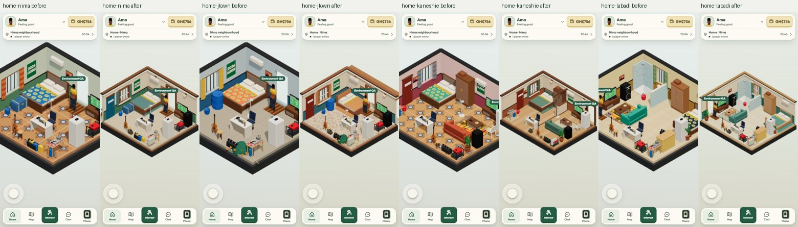
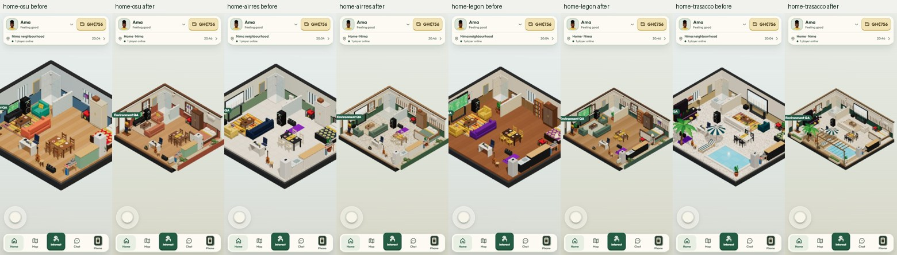
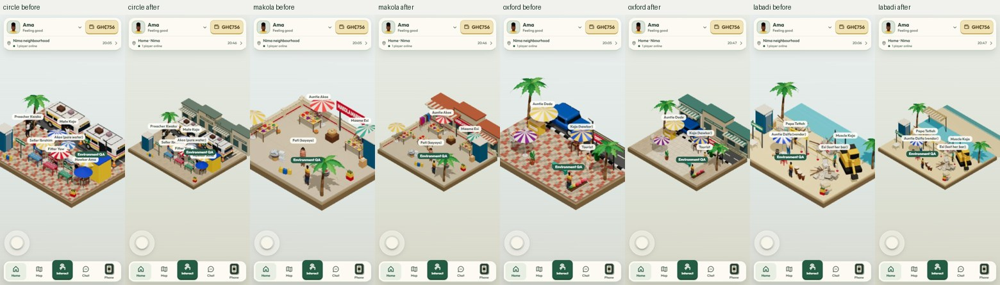
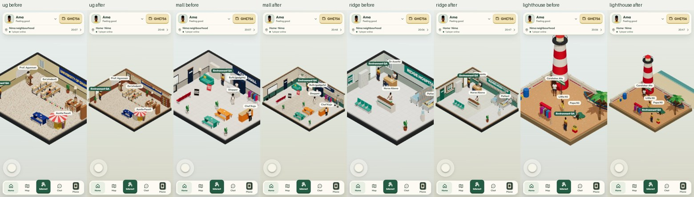
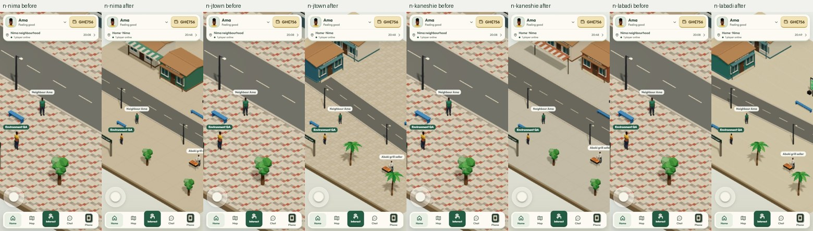
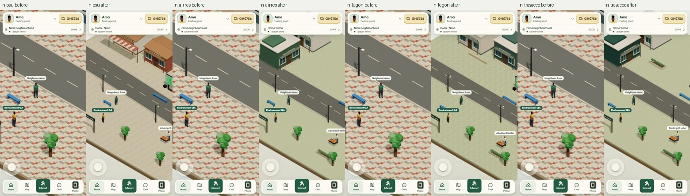

# Phase 4 — buildings, interiors and environmental art

Implemented and reviewed 15–16 October 2026, from baseline `bdf4c42`.
Cost: GH₵0. This preserves the JavaScript/Three.js/Vite architecture,
portrait HUD, room multiplayer and server-controlled gameplay.

## 1. Original environment problems

The audit covered `main.js`, room/kit/home/venue/neighbourhood specifications,
world lifecycle, camera framing, stage lighting, screens, poses, ride batching,
server catalogue/actions and estate pagination. There were 63 environments and
172 distinct prop kinds in their original specifications. Existing beds, seating,
kitchens, washrooms, offices, market goods and landmarks provided useful reusable
models, but their presentation lacked a cohesive architectural finish.

The main defects were repetitive streets/estates, weak wall and window edges,
competing floor/fabric patterns, incomplete spatial zoning, little outdoor venue
context and cutaway edges cropped on portrait screens. Night lighting changed
abruptly; fans/screens/smoke ignored reduced motion. The Osu bathroom, church
keyboard and funeral DJ had disconnected approaches. Failed navigation could
fall back to walking through obstacles.

Room teardown disposed shared geometry without ownership tracking while leaving
cloned floor/sign/screen resources behind. Estate removal and travel recycling
also needed explicit material/texture ownership. Baseline images and metrics were
captured before editing the renderer.

## 2. Complete environment coverage inventory

All 55 destination IDs, eight home IDs, zone/action IDs and existing item indices
remain intact. Decorations are appended or placed in a separate noninteractive
art group. The 68 Phase 3 districts, geographic data, map, LOD and destinations
are unchanged. No new gameplay location or action was introduced.

The tables link all 63 before/after scenes. Homes use a demanding all-equipment
render configuration; tests separately cover empty/full/single/absent equipment.
Estate captures use three synthetic owner records. Live estate buildings still
come only from server ownership records. Synthetic coverage uses the actual
authenticated renderer without writing server state; its HUD retains the QA
account's real location, so use the table's scene identifier to identify the art.
This render coverage is separate from the actual server-route checks below.

### Homes

| Scene ID | Existing location | Before → after items | Zones | Review |
| --- | --- | ---: | ---: | --- |
| `home-nima` | Single room · Nima | 24 → 26 | 8 | [Before](images/environments/before/home-nima.jpg) · [After](images/environments/after/home-nima.jpg) |
| `home-jtown` | Fisher room · Jamestown | 24 → 26 | 8 | [Before](images/environments/before/home-jtown.jpg) · [After](images/environments/after/home-jtown.jpg) |
| `home-kaneshie` | Chamber & hall · Kaneshie | 26 → 29 | 8 | [Before](images/environments/before/home-kaneshie.jpg) · [After](images/environments/after/home-kaneshie.jpg) |
| `home-labadi` | Self-contain · La | 27 → 30 | 9 | [Before](images/environments/before/home-labadi.jpg) · [After](images/environments/after/home-labadi.jpg) |
| `home-osu` | 1-bed apartment · Osu | 28 → 31 | 9 | [Before](images/environments/before/home-osu.jpg) · [After](images/environments/after/home-osu.jpg) |
| `home-airres` | 2-bed flat · Airport Residential | 29 → 32 | 9 | [Before](images/environments/before/home-airres.jpg) · [After](images/environments/after/home-airres.jpg) |
| `home-legon` | Family house · East Legon | 33 → 36 | 9 | [Before](images/environments/before/home-legon.jpg) · [After](images/environments/after/home-legon.jpg) |
| `home-trasacco` | Villa · Trasacco Valley | 36 → 39 | 9 | [Before](images/environments/before/home-trasacco.jpg) · [After](images/environments/after/home-trasacco.jpg) |

### Ordinary venues

| Scene ID | Existing location | Before → after items | Zones | Review |
| --- | --- | ---: | ---: | --- |
| `circle` | Kwame Nkrumah Circle | 29 → 29 | 9 | [Before](images/environments/before/circle.jpg) · [After](images/environments/after/circle.jpg) |
| `muni` | Auntie Muni's Waakye | 19 → 19 | 2 | [Before](images/environments/before/muni.jpg) · [After](images/environments/after/muni.jpg) |
| `makola` | Makola Market | 16 → 18 | 4 | [Before](images/environments/before/makola.jpg) · [After](images/environments/after/makola.jpg) |
| `kantamanto` | Kantamanto Market | 14 → 14 | 2 | [Before](images/environments/before/kantamanto.jpg) · [After](images/environments/after/kantamanto.jpg) |
| `chopbar` | Who Jah Bless Chop Bar | 19 → 19 | 4 | [Before](images/environments/before/chopbar.jpg) · [After](images/environments/after/chopbar.jpg) |
| `kenkey` | Sweet Mother Kenkey | 15 → 15 | 2 | [Before](images/environments/before/kenkey.jpg) · [After](images/environments/after/kenkey.jpg) |
| `oxford` | Oxford Street, Osu | 17 → 17 | 4 | [Before](images/environments/before/oxford.jpg) · [After](images/environments/after/oxford.jpg) |
| `vibes` | Vibes Lounge, Osu | 17 → 17 | 4 | [Before](images/environments/before/vibes.jpg) · [After](images/environments/after/vibes.jpg) |
| `hub` | Sankofa Tech Hub, Osu | 21 → 21 | 4 | [Before](images/environments/before/hub.jpg) · [After](images/environments/after/hub.jpg) |
| `bank` | Gold Coast Bank, Ridge | 16 → 16 | 3 | [Before](images/environments/before/bank.jpg) · [After](images/environments/after/bank.jpg) |
| `ridge` | Ridge Hospital | 15 → 15 | 3 | [Before](images/environments/before/ridge.jpg) · [After](images/environments/after/ridge.jpg) |
| `korlebu` | Korle Bu Teaching Hospital | 18 → 18 | 3 | [Before](images/environments/before/korlebu.jpg) · [After](images/environments/after/korlebu.jpg) |
| `police` | Osu Police Station | 13 → 13 | 1 | [Before](images/environments/before/police.jpg) · [After](images/environments/after/police.jpg) |
| `memorial` | Kwame Nkrumah Memorial Park | 18 → 18 | 2 | [Before](images/environments/before/memorial.jpg) · [After](images/environments/after/memorial.jpg) |
| `blackstar` | Black Star Square | 14 → 14 | 2 | [Before](images/environments/before/blackstar.jpg) · [After](images/environments/after/blackstar.jpg) |
| `castle` | Osu Castle | 13 → 13 | 2 | [Before](images/environments/before/castle.jpg) · [After](images/environments/after/castle.jpg) |
| `lighthouse` | Jamestown Lighthouse | 12 → 12 | 1 | [Before](images/environments/before/lighthouse.jpg) · [After](images/environments/after/lighthouse.jpg) |
| `bukom` | Bukom Boxing Arena | 13 → 13 | 3 | [Before](images/environments/before/bukom.jpg) · [After](images/environments/after/bukom.jpg) |
| `canoes` | Jamestown Canoe Beach | 11 → 11 | 2 | [Before](images/environments/before/canoes.jpg) · [After](images/environments/after/canoes.jpg) |
| `labadi` | Labadi Beach | 23 → 23 | 8 | [Before](images/environments/before/labadi.jpg) · [After](images/environments/after/labadi.jpg) |
| `funeral` | La Funeral Grounds | 15 → 15 | 3 | [Before](images/environments/before/funeral.jpg) · [After](images/environments/after/funeral.jpg) |
| `church` | Glorious Fire Ministry | 23 → 23 | 3 | [Before](images/environments/before/church.jpg) · [After](images/environments/after/church.jpg) |
| `mosque` | Nima Central Mosque | 13 → 13 | 2 | [Before](images/environments/before/mosque.jpg) · [After](images/environments/after/mosque.jpg) |
| `stadium` | Accra Sports Stadium | 8 → 8 | 2 | [Before](images/environments/before/stadium.jpg) · [After](images/environments/after/stadium.jpg) |
| `viewing` | Nima Football Viewing Centre | 15 → 15 | 2 | [Before](images/environments/before/viewing.jpg) · [After](images/environments/after/viewing.jpg) |
| `radio` | Sankofa FM Studios | 15 → 15 | 2 | [Before](images/environments/before/radio.jpg) · [After](images/environments/after/radio.jpg) |
| `mall` | Accra Mall | 23 → 23 | 5 | [Before](images/environments/before/mall.jpg) · [After](images/environments/after/mall.jpg) |
| `ug` | University of Ghana, Legon | 18 → 18 | 3 | [Before](images/environments/before/ug.jpg) · [After](images/environments/after/ug.jpg) |
| `airport` | Kotoka International Airport | 16 → 16 | 3 | [Before](images/environments/before/airport.jpg) · [After](images/environments/after/airport.jpg) |
| `hotel` | Labadi Beach Hotel | 20 → 20 | 5 | [Before](images/environments/before/hotel.jpg) · [After](images/environments/after/hotel.jpg) |
| `ama` | Accra Metropolitan Assembly | 15 → 15 | 2 | [Before](images/environments/before/ama.jpg) · [After](images/environments/after/ama.jpg) |
| `cars` | Correct Cars, Spintex Road | 13 → 13 | 2 | [Before](images/environments/before/cars.jpg) · [After](images/environments/after/cars.jpg) |
| `momo` | Blessed MoMo Agent | 10 → 10 | 1 | [Before](images/environments/before/momo.jpg) · [After](images/environments/after/momo.jpg) |
| `cinema` | Silverbird Cinemas, Accra Mall | 14 → 14 | 2 | [Before](images/environments/before/cinema.jpg) · [After](images/environments/after/cinema.jpg) |
| `court` | Law Court Complex, High Street | 3 → 5 | 2 | [Before](images/environments/before/court.jpg) · [After](images/environments/after/court.jpg) |
| `aboki` | Aboki Khebab Joint, Oxford Street | 3 → 3 | 1 | [Before](images/environments/before/aboki.jpg) · [After](images/environments/after/aboki.jpg) |
| `fanyogo` | FanYogo Ice Cream Stop, Circle | 3 → 3 | 1 | [Before](images/environments/before/fanyogo.jpg) · [After](images/environments/after/fanyogo.jpg) |
| `restaurant` | Oxford Street Restaurant, Osu | 4 → 6 | 1 | [Before](images/environments/before/restaurant.jpg) · [After](images/environments/after/restaurant.jpg) |
| `gymlegon` | East Legon Fitness Club | 3 → 5 | 1 | [Before](images/environments/before/gymlegon.jpg) · [After](images/environments/after/gymlegon.jpg) |

### Neighbourhoods

| Scene ID | Existing location | Before → after items | Zones | Review |
| --- | --- | ---: | ---: | --- |
| `n-nima` | Nima neighbourhood | 20 → 20 | 10 | [Before](images/environments/before/n-nima.jpg) · [After](images/environments/after/n-nima.jpg) |
| `n-jtown` | Jamestown neighbourhood | 19 → 19 | 9 | [Before](images/environments/before/n-jtown.jpg) · [After](images/environments/after/n-jtown.jpg) |
| `n-kaneshie` | Kaneshie neighbourhood | 19 → 19 | 9 | [Before](images/environments/before/n-kaneshie.jpg) · [After](images/environments/after/n-kaneshie.jpg) |
| `n-labadi` | Labadi neighbourhood | 19 → 19 | 9 | [Before](images/environments/before/n-labadi.jpg) · [After](images/environments/after/n-labadi.jpg) |
| `n-osu` | Osu neighbourhood | 19 → 19 | 9 | [Before](images/environments/before/n-osu.jpg) · [After](images/environments/after/n-osu.jpg) |
| `n-airres` | Airport Residential neighbourhood | 19 → 19 | 9 | [Before](images/environments/before/n-airres.jpg) · [After](images/environments/after/n-airres.jpg) |
| `n-legon` | East Legon neighbourhood | 19 → 19 | 9 | [Before](images/environments/before/n-legon.jpg) · [After](images/environments/after/n-legon.jpg) |
| `n-trasacco` | Trasacco neighbourhood | 19 → 19 | 9 | [Before](images/environments/before/n-trasacco.jpg) · [After](images/environments/after/n-trasacco.jpg) |

### Estates

| Scene ID | Existing location | Before → after items | Zones | Review |
| --- | --- | ---: | ---: | --- |
| `e-nima` | Nima player estate | 4 → 4 | 1 | [Before](images/environments/before/e-nima.jpg) · [After](images/environments/after/e-nima.jpg) |
| `e-jtown` | Jamestown player estate | 4 → 4 | 1 | [Before](images/environments/before/e-jtown.jpg) · [After](images/environments/after/e-jtown.jpg) |
| `e-kaneshie` | Kaneshie player estate | 4 → 4 | 1 | [Before](images/environments/before/e-kaneshie.jpg) · [After](images/environments/after/e-kaneshie.jpg) |
| `e-labadi` | Labadi player estate | 4 → 4 | 1 | [Before](images/environments/before/e-labadi.jpg) · [After](images/environments/after/e-labadi.jpg) |
| `e-osu` | Osu player estate | 4 → 4 | 1 | [Before](images/environments/before/e-osu.jpg) · [After](images/environments/after/e-osu.jpg) |
| `e-airres` | Airport Residential player estate | 4 → 4 | 1 | [Before](images/environments/before/e-airres.jpg) · [After](images/environments/after/e-airres.jpg) |
| `e-legon` | East Legon player estate | 4 → 4 | 1 | [Before](images/environments/before/e-legon.jpg) · [After](images/environments/after/e-legon.jpg) |
| `e-trasacco` | Trasacco player estate | 4 → 4 | 1 | [Before](images/environments/before/e-trasacco.jpg) · [After](images/environments/after/e-trasacco.jpg) |

## 3. Shared rendering and architecture improvements

The cutaway gains layered wall caps/cornices, timber reveals, window mullions and
sills, door frames/thresholds, wall fixtures and restrained wall relief. Floor
inlays separate sleeping, wet, work and terrace areas. Low dividers add depth
while keeping circulation and front sightlines open. Wall/floor art is excluded
from item picking; added solid furniture participates in navigation.

Plain kit surfaces merge using vertex colours; textures, transparency, emissive
surfaces and moving parts stay separate. Rounded furniture uses one rounding
segment rather than two. Upholstered bed backs, sofa cushions, cabinet doors and
handles, refrigerator grilles and toilet details refine common props. Existing
desks, seating, shelving, TVs, cookers and washroom equipment retain use points
and receive shared material/architectural treatment. Rectangular pitched canopy
panels fix the old scaled cone extending beyond narrow supporting frames.

Camera fitting includes slab width, wall height and HUD clearance. The portrait
cropping multiplier is removed. Resize preserves pan and relative zoom,
including closer street views, and restores scale when returning to the original
viewport. The existing Phase 2 interface remains the only gameplay HUD.

## 4. All eight home improvements

| Home | Composition and finish |
| --- | --- |
| Nima | Compact courtyard room, muted green plaster, concrete floor, framed openings and planted compound edge. |
| Jamestown | Coastal blue, terrazzo, shutters, shallow rear veranda, rotated bed and compact furniture arrangement. |
| Kaneshie | Wood chamber-and-hall, low divider, overhead threshold and differentiated sleeping/living surfaces. |
| Labadi | Teal coastal studio, tiled wet area, existing glazed washroom and low spatial separation. |
| Osu | Terracotta/wood apartment, planted veranda railing and corrected bathroom circulation around desk, table and half wall. |
| Airport Residential | Green/terrazzo garden flat, wall relief, quieter finishes and divided bedroom/living composition. |
| East Legon | Darker wood family court, low partition, grouped dining/living furniture and garden terrace edge. |
| Trasacco | Cream stone villa, pool deck, timber pergola, landscaping and separated indoor/terrace surfaces. |

Existing owned-item filters remain authoritative. TV, laptop, cooking equipment,
fridge, speaker, guitar, exercise equipment and generator retain their rules.
Purchased bed quality gains a visible topper; owned solar and camera equipment
gain noninteractive representations. Built-in equipment in higher tiers stays
built in. Decorations grant no functional item or action. Balances, housing costs
and saved-state formats are unchanged.

## 5. Venue-category improvements

| Category and complete ordinary IDs | Treatment |
| --- | --- |
| Transport: circle, airport | Commercial backdrop, transport signage/crossing details at Circle; coordinated airport architectural finishing. |
| Markets: makola, kantamanto | Articulated shop fronts, shade and cohesive displays; two additional noninteractive Makola displays with paths checked. |
| Food: muni, chopbar, kenkey, restaurant, aboki, fanyogo | Preparation/service props retained, with appropriate canopies, shelving, glow or commercial context. |
| Retail: oxford, mall, cars, momo | Framed frontage/interiors, coordinated surfaces and display hierarchy. |
| Night/media: vibes, viewing, cinema, radio | Dark wall finishes, restrained panels/glow and existing animated screens. |
| Office: hub, bank | Carpet inlays, wall relief and wood/green finishes around working equipment. |
| Medical: ridge, korlebu | Pale clean surfaces, dado rails, reception signs and central circulation. |
| Civic: police, court, ama | Public floor hierarchy and contextual furnishing; custody controls retained. |
| Heritage: memorial, blackstar, castle, lighthouse | Existing landmark silhouettes with landscaped or coastal surroundings. |
| Coast: canoes, labadi | Sand/water edges, shade, hospitality framing and restrained water motion. |
| Fitness: bukom, stadium, gymlegon | Equipment/use points retained; gym mirror, bench and muted training surface. |
| Community: funeral, church, mosque | Corrected funeral roof proportions and DJ approach; coherent aisles and wall treatment. |
| Campus: ug | Terracotta beam, study signage, paving and coordinated campus finishes. |
| Hotel: hotel | Stone inlays and layered architectural edges around lobby/pool/hospitality activities. |

The catalogue contains no ordinary Tema venue, so none was invented. Existing
Phase 3 metropolitan scenery remains available on the map.

## 6. Neighbourhood and estate variations

Art reuses Phase 3 district architectural families through the eight home
identities, without introducing a competing geography system. Nima has compact
compound frontage; Jamestown an inward coastal lane; Kaneshie a broad commercial
road and side-facing frontage; Labadi sand/palms; Osu a paved commercial court;
Airport Residential planted modern setbacks; East Legon staggered modern
composition; Trasacco villa frontage, larger setbacks and formal planting.

Shop positions/facing, road widths/angles, viewing areas, benches, vendors,
paving, vegetation, boundary rhythm and lights differ. Existing zone indices,
vendor schedules, patrol behaviour, spawn definitions, exits and home/estate
routes are retained. A blocked authored spawn resolves to its nearest free cell
for rendering; custody retains its original restricted spawn.

All estates have twelve authored plots. Jamestown uses inward coastal lanes;
Osu a perimeter courtyard; East Legon staggered rows; Labadi inward outer plots
and sandy approaches; Trasacco landscaped villa courts. The other districts have
their own setbacks, surfaces and court spacing. Server owner pages determine
occupied buildings. Empty estates create no houses. All 96 plot approaches are
tested. These remain bounded local scenes; connected exploration is Phase 5.

## 7. Lighting and atmosphere

One interpolated profile covers morning, noon, afternoon, sunset and night using
the existing Accra time source. Ambient/key/fill colour/intensity, backdrop,
interior/street lamps and window/fixture glow change smoothly through midnight.
Night remains readable. Rooms add at most two unshadowed point lights while
keeping the stage's single shadow key; no bloom or particle system was added.

Existing fan/smoke/screen motion and new subtle coastal water motion respect
reduced motion. Player movement and NPC behaviour continue. The existing audio
foundation is retained; no new recordings, music or large audio system was added.

## 8. Interaction and walkability validation

Tests cover eight homes × 26 equipment combinations = 208 home cases, all 55
destinations and twelve occupied plots per estate. They validate zone-item
references, action IDs, NPC seats, bounds, unobstructed resolved spawns, exits
and connected approaches. Failed paths return no route instead of a direct walk
through walls. The Osu bathroom, church keyboard and funeral DJ were adjusted
after reachability failures. Decorations cannot steal taps from usable objects.

Real cookie-authenticated browser checks exercise home → street → estate →
street → home. The separate HUD journey covers contextual/canvas selection,
activity confirmation/cancellation, needs recovery, joystick input, reconnect,
nearby players, messaging and public transport. Section 11 records the outcome.

## 9. Performance before and after

The actual production client was captured in Chromium SwiftShader at 390×844,
pixel ratio 0.7 and hour 13. The map is disposed to isolate room resources.
Five GPU-fenced frames are sampled per scene. The complete
[metrics](environment-metrics.json) retain all 63 scenes, geometry bytes,
mesh/material counts, GPU geometry/texture counts, initialization and frame
samples. Existing avatars are included in scene counts.

| Scene | Draw calls before → after | Triangles before → after |
| --- | ---: | ---: |
| Single room · Nima | 117 → 85 | 60,722 → 47,766 |
| Chamber & hall · Kaneshie | 126 → 92 | 65,250 → 50,534 |
| Family house · East Legon | 166 → 127 | 84,682 → 61,660 |
| Villa · Trasacco Valley | 192 → 139 | 90,258 → 69,122 |
| Makola Market | 127 → 88 | 171,592 → 167,770 |
| Kwame Nkrumah Circle | 245 → 169 | 279,500 → 248,742 |
| Vibes Lounge, Osu | 127 → 99 | 147,454 → 137,134 |
| Labadi Beach | 147 → 94 | 196,844 → 171,502 |
| Jamestown neighbourhood | 60 → 64 | 91,162 → 97,364 |
| East Legon player estate | 40 → 32 | 38,000 → 43,734 |

| Scene | GPU geometries B → A | GPU textures B → A | Init ms B → A | Median software frame ms B → A |
| --- | ---: | ---: | ---: | ---: |
| home-nima | 120 → 85 | 17 → 20 | 486 → 1816 | 7.0 → 5.5 |
| home-kaneshie | 132 → 92 | 25 → 23 | 144 → 257 | 4.4 → 4.6 |
| home-legon | 180 → 128 | 42 → 39 | 185 → 255 | 28.1 → 41.4 |
| home-trasacco | 202 → 140 | 48 → 43 | 991 → 306 | 5.0 → 4.7 |
| makola | 171 → 132 | 105 → 84 | 646 → 966 | 5.0 → 27.2 |
| circle | 244 → 168 | 87 → 78 | 10792 → 5155 | 9.6 → 7.4 |
| vibes | 236 → 205 | 144 → 96 | 508 → 436 | 4.9 → 33.7 |
| labadi | 265 → 212 | 214 → 113 | 956 → 957 | 55.2 → 48.6 |
| n-jtown | 198 → 177 | 310 → 130 | 66 → 108 | 3.2 → 42.8 |
| e-legon | 157 → 149 | 308 → 114 | 92 → 127 | 22.6 → 1.7 |

Initialization includes synchronous teardown/build/avatars. Repeated transition
timings include first render. The first Nima sample includes cold setup; scene
order affects caches. Software frame times vary with shader compilation, CPU
load and the software GPU. Some new context increases geometry/draw calls and
is reported alongside reductions. These observations establish no physical-phone
FPS result; the approximately 30 FPS device target remains unmeasured.

## 10. Resource ownership and disposal

Room shell/art and each item own resource scopes. Shared geometry/material
references are counted; materials retain unique texture dependencies. Removal
releases only that object's ownership. Disposal is idempotent, includes floor,
sign and animated-screen clones, clears room references and removes only its
lights. Avatars retain their separate lifecycle.

Idle cache targets are 160 geometry templates, 96 materials and 48 direct
textures. Active resources are never evicted. Material dependencies can retain
textures above the direct target until those materials become idle. Travel
segments/recycling use compatible scopes; six fixed atlas/material references
stay intentionally resident. Attached tray/helmet props have separate ownership.
Travel batching preserves authored vertex colours. No character-art change is
involved.

Browser stress completed **40 room transitions** (ten repeats of home → Makola →
Osu street → East Legon estate). The final four comparable end-scene samples held
**77 geometries / 53 textures**. The same renderer then refreshed all twelve
estate owners with unique labels **24 times**: the final eight samples held
**99 geometries / 80 textures**. Warm caches grow before reaching that plateau.
The median measured transition including first render was **597 ms**
(range 194–2587 ms on this desktop software renderer).
Node tests separately check 24 complete room lifetimes and 192 individual house
replacements, including two concurrently live owners of shared geometry/materials.

These are renderer resource counts, not process RAM/GPU byte measurements.
Baseline sequential coverage showed accumulated textures across different scenes;
all values are retained in the metrics. A dedicated repeated-cycle baseline was
not captured, so no numeric before/after leak-rate comparison is claimed.

## 11. Automated and browser tests

- Full client suite: 39 passing tests, including eleven environment regressions.
- Full server suite: 44 passing tests. No server gameplay implementation changed.
- Production build: passed.
- All 63 scene captures: completed with zero browser page errors.
- Home ownership, destination/estate navigation, shared live resources, repeated
  lifetimes, canopy bounds, travel colour batching and lighting continuity: passed.
- Five requested viewport sizes: home/street player and controls checked;
  camera scale restores after resizing; reduced motion freezes decoration while
  movement continues.

The broad HUD journey passed all five layouts, canvas picking, reduced motion,
focus retention, phone confirmations, pointer/joystick isolation, rejected actions,
activity start/cancel/completion, needs recovery and reconnect. Multiplayer
discovery, wave, city chat and friendly Oware acceptance also ran successfully.
A later rerun timed out dismissing the Oware result, and an earlier run was
interrupted by a local database timeout; this is not reported as an uninterrupted
full HUD-suite pass.

The focused environment journey independently verifies two live players, remote
joystick movement, city chat and server-acknowledged private-message delivery.
The journey also verifies a server-charged trotro fare, reload during travel,
arrival at Circle and removal of the ride rendering override.

Travel renderer stress separately exercised trotro, okada and walking, including
11 segment recycles in total. All segment, base-scene and attached-prop scopes
were empty after stop; the existing room rendered again, with no browser page
errors. Fixed atlas and bounded character caches remain resident by design.

The focused multiplayer/travel browser run completed successfully, with zero
page errors. [Circle arrival](images/environments/circle-arrival.jpg) shows the
actual authoritative destination and HUD after the journey.

Checks use the isolated local `awd_security` database, Redis namespace,
production cookie authentication and disposable accounts. Browser helpers reject
non-local URLs. Credentials remain in ignored `.local`. Renderer coverage is in
`tools/environment-browser-test.py`; routes/resources are in
`tools/environment-lifecycle-test.py`; focused multiplayer/travel is in
`tools/environment-gameplay-test.py`; broader HUD coverage is in
`tools/hud-browser-test.py`.
This is not a full manual accessibility or physical-device performance audit.

## 12. Before-and-after screenshots

Section 2 links every before/after image. Comparison sets below cover all eight
homes, eight contrasting venues and all eight streets, plus night/viewport
evidence. Every home, ordinary venue, street and estate was visually reviewed.
Review caught the stretched funeral canopy and insufficient shop-facing variation;
the final captures show those corrections. Synthetic render captures preserve
the live HUD and account, as explained in section 2.

Full scene review sheets: [sheet 1](images/environments/review-1.jpg), [sheet 2](images/environments/review-2.jpg), [sheet 3](images/environments/review-3.jpg), [sheet 4](images/environments/review-4.jpg), [sheet 5](images/environments/review-5.jpg), [sheet 6](images/environments/review-6.jpg), [sheet 7](images/environments/review-7.jpg), [sheet 8](images/environments/review-8.jpg).

Night examples: [home-nima](images/environments/after/home-nima-night.jpg), [home-trasacco](images/environments/after/home-trasacco-night.jpg), [vibes](images/environments/after/vibes-night.jpg), [labadi](images/environments/after/labadi-night.jpg), [n-osu](images/environments/after/n-osu-night.jpg).

Lighting sequence: [7:00](images/environments/layouts/light-7.jpg), [13:00](images/environments/layouts/light-13.jpg), [18:00](images/environments/layouts/light-18.jpg), [22:00](images/environments/layouts/light-22.jpg).

Viewport evidence: [375×812](images/environments/layouts/home-375x812.jpg), [390×844](images/environments/layouts/home-390x844.jpg), [430×932](images/environments/layouts/home-430x932.jpg), [390×530](images/environments/layouts/home-390x530.jpg), [844×390](images/environments/layouts/home-844x390.jpg).

## 13. Files changed

- New `scene/environment-profiles.js`, `environment-art.js`,
  `environment-light.js`, `environment-resources.js`: art direction, shared
  architecture, lighting and ownership.
- `scene/kit.js`, `homes.js`, `venues.js`, `neighbourhood.js`: furniture,
  materials, layouts, owner plots and reachability corrections.
- `scene/room.js`, `world.js`, `stage.js`, `frame.js`: lifecycle, picking,
  lighting, spawn resolution and responsive camera.
- `scene/ride.js`, `bake.js`: shared-resource and vertex-colour compatibility.
- `client/test/environment-fixture.js`, `environments.test.js`,
  `test/fixtures/environment-contract.json`,
  `client/package.json`: regression fixtures/tests and suite inclusion.
- `tools/environment-browser-test.py`, `environment-lifecycle-test.py`,
  `environment-gameplay-test.py`:
  local authenticated render/route/resource checks.
- This report, metrics, JPEG evidence, provenance and roadmap update.

Scene paths are relative to `client/src/v2/`. No migration, economy change,
character asset replacement or public deployment change is included.

## 14. Known limitations

These are stylized modular dioramas, not spatial replicas of each real building.
Existing functional furniture uses lightweight procedural silhouettes. Peripheral
shopfronts/coast strips are scenic. Synthetic scene captures do not prove server
travel to every destination; catalogue/action tests and actual representative
journeys provide separate coverage.

Streets remain bounded scenes with pan/zoom/follow. Estate residents use existing
twelve-owner pagination. All-equipment starter screenshots are deliberately more
crowded than ordinary inventory. NPC/character animation stays as before;
character quality is reserved for the final phase. Physical-phone FPS and
long-duration device-memory testing remain unmeasured.

## 15. Approval and provenance

No further approval is needed for this local implementation. Production
deployment, destructive data operations, saved-state incompatibility and major
architecture/monetization changes retain the project's explicit approval rule.
No public deployment or Phase 5 implementation was performed.

All added environmental geometry, layouts and patterns are original project
work. No downloaded art, paid dependency, uncertain asset licence or recording
was introduced. Existing Phase 3 metadata retains its provenance. See
[environment art provenance](../client/public/assets/ENVIRONMENT-ART.md).

Delivery targets the existing `origin/main` repository at
[Daxomar/awd](https://github.com/Daxomar/awd). Local preview uses port 8080.
The isolated QA server uses port 8082; the user's saved game database was not
used for disposable account, messaging or travel tests.
