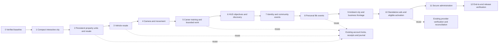

# Living Virtual Accra implementation log

Authority: [the owner's full completion brief](brief.md). Codex executed Stages 0–1 and began
Stage 2; Claude took over the program on 2026-10-16 (same rules, gates and log format). This extends the existing
application; GH₵0 additional services/assets. No public deployment or live payments.
Character production remains a separate Blender workstream.

## Ordered stages and dependencies

| Stage | Status | Required completion proof |
| --- | --- | --- |
| 0 | Complete; [checkpoint](stage0/checkpoint.md) | Current tests/build, inventory, authenticated baseline, protected interfaces |
| 1 | Complete; [checkpoint](stage1/checkpoint.md) | Authored compact presentation, dual coordinates, every destination usable, geographic mode, screenshots and resource tests |
| 2 | Complete locally (CI pending); [checkpoint](stage2/checkpoint.md) | Finite units, legacy ownership separation, tours, persistent furnishing/renovation, primary residence, concurrent furnished resale |
| 3 | Complete locally (CI pending); [checkpoint](stage3/checkpoint.md) | Existing vehicle compatibility, inspection/cosmetics, secure transfer/cancellation and two-player reload proof |
| 4 | Complete locally (CI pending); [checkpoint](stage4/checkpoint.md) | Camera preference/toggle, collision, mobile controls, doors and remote movement in actual rooms |
| 5 | Complete locally (CI pending; salary proposal awaits approval); [checkpoint](stage5/checkpoint.md) | All 19 career requirements, real courses/assessments, short work, shift uniqueness, bounded auto-work; gated balance proposal |
| 6 | Complete locally (CI pending); [checkpoint](stage6/checkpoint.md) | Visible nonblocking HUD guidance; real consenting discovery; empty-server, block and reward replay tests |
| 7 | Complete locally (CI pending; event XP crediting awaits approval); [checkpoint](stage7/checkpoint.md) | Privacy-controlled identity, authorized gatherings, moderated scheduling and durable real attendance |
| 8 | Complete locally (CI pending); [checkpoint](stage8/checkpoint.md) | Curated contextual events, bounded authoritative choices, fair neutral expiry, replay/disconnect tests |
| 9 | Complete locally (CI pending; no phone FPS measured); [checkpoint](stage9/checkpoint.md) | Bounded ambient schedules/pooling/LOD, distinguish NPCs from real players, actual business frontage |
| 10 | Complete locally with simulated Paystack (live key not enabled); [checkpoint](stage10/checkpoint.md) | Real standalone booking/management, safe media, verified payment return, eligible auto-activation and suspension |
| 11 | Complete locally (CI step added; activity history starts at deployment); [checkpoint](stage11/checkpoint.md) | Separate secure UI, server-enforced roles, audit, actual metrics, restricted moderation/payment/world controls |
| 12 | Not started | Journeys A–O, final economy simulations, exploit tests, mobile diagnostics, Docker, policies/release gates |

Each stage must record its exact files, data changes, tests/results, gameplay
evidence, performance, limitations, regressions/fixes and next-stage readiness.
No stage is complete based on UI alone. The whole program remains incomplete
until all acceptance criteria are met; physical-device or merchant certification
cannot be inferred from desktop CI.

## Compatibility and approval boundaries

Keep existing destination coordinates/IDs and server fares independent of display
positions. Preserve wallets, birth GH₵800/GH₵25,000 and odds, salaries, rent, owned
homes/cars/items, relationships, payment history and character look fields.
Use existing transaction reservations, sorted locks, receipts and journal.

New property/vehicle ownership must coexist with legacy state before activation.
New salary time compression, auto-work and economy configuration must have explicit
proposals and remain gated where they materially change production earnings.
First Friend cash stays disabled. No paid service, public deployment, production
migration, cash-out, player reset or incompatible migration is authorized.

## Baseline architecture / integration guide

Browser: `client/src/v2/main.js` coordinates one Three.js stage, rooms/map,
plain DOM HUD/phone and `net.js`. `server/src/index.js` owns HTTP, cookie auth,
WebSocket admission and additive startup migrations. `shard.js` coordinates live
players and bounded account queues. Game rules and life services validate actions;
`account-money.js` persists state/events with PostgreSQL row locks and receipts.
Redis supplies presence, rate limits, leases and delivery. Existing schema is
listed in [the baseline inventory](stage0/inventory.json).

A financial request enters an authenticated WebSocket, passes admission/rate and
account queue checks, reserves the account, reads canonical state under a database
lock, validates eligibility, writes state/journal/receipt together, then publishes
the result. Financial uncertainty disconnects for canonical reload rather than
overwriting a committed result from stale memory. Extend this path.

Use plain ES modules, kebab-case files and Node's test runner. Build with client
`npm run build`; test each package with `npm test`. CI runs all five PostgreSQL
integration scripts and a full disposable Docker cookie-authenticated smoke.
New unit tests must be included in package scripts. Use local disposable cookie
accounts for browser checks. Never print credentials or individual account data.

Claude owns `characters/`, character GLBs/manifests and the avatar/model/wardrobe
runtime modules. Stage work may integrate through stable interfaces but must not
overwrite concurrent edits. The root AGENTS.md already contains these rules and
is retained without replacing project-specific guidance.
