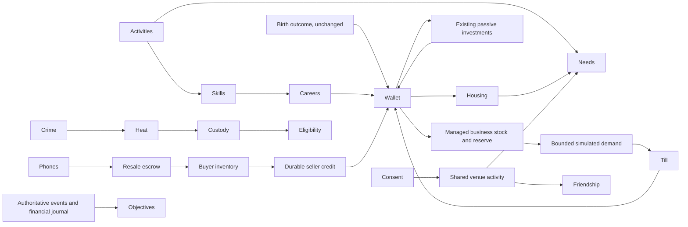

# Phase 8 audit and implementation contract

16 October 2026, baseline 9434241. Character pipeline has concurrent uncommitted
work; it is excluded. Phases 6/7 remain postponed. No public deployment or Phase 9.

| System | Verified implementation | Gap addressed in Phase 8 |
| --- | --- | --- |
| Careers | 19 five-rank careers, grades, schedules, skills, hourly attendance, three physical assignments | Lost history on switching; assignments not connected to career history/reputation; promotion visibility |
| Skills | Ten stable 0–10 fields, trait-adjusted diminishing growth; salary eligibility, gigs, activities | Explain real effects and preserve transferable experience |
| Wallet | Cash/MoMo, bounded JSON history, PostgreSQL credits/transfers, withMoney transaction boundary | Many game purchases/completions only periodically saved; permanent gameplay journal missing |
| Inventory | Household booleans, wardrobe, four uniquely identified Circle phones | No controlled player resale/escrow |
| Shops | Existing item prices, clothing and phone catalogue | Inventory/finance connections and validation gaps |
| Housing | Eight home IDs, advance rent, ownership/estates, private entry, comfort/bed | Invalid cooking can consume ingredients before eligibility; fridge/AC benefit unclear |
| Businesses | Ten passive investment IDs, daily random income, absentee discount | No stock, pricing, till, operating expense or statement model; preserve legacy investments |
| Crime | Three abstract timed outcomes, heat, random detection, fines, custody/free bail | Separate legal standing, transparent risk/accounting and recovery, no player targeting |
| Social | Room socials, mirrored JSON friendship points, asks/proposals in memory, DMs/requests/blocking | No durable friend consent, atomic mutual relationship persistence, ending or shared timed activities |
| Reputation/needs | Global rep/XP, six needs, offline floors, rent/food/skills/equipment effects | Separate professional, business, social and legal dimensions |
| NPCs | Atmospheric venue/street interfaces | Phase 7 autonomous NPCs explicitly excluded; demand is a disclosed numerical model |
| Objectives | Twelve authoritative milestones plus existing aspirations | Add bounded medium/long-term milestones from real events |
| Payments/ads | Shared Paystack ledger, signed return, webhook/verification/reconciliation, reservations/reports | Isolated and unchanged; no cash-out or live activation |
| Validation | Room authority, cookies, account lease, origin/rate checks, withMoney | Extend existing transaction discipline, not shard/engine replacement |

`initial-inventory.json` records all careers, skills, household items, home IDs,
investment definitions, destination/action IDs and actual public schema names.

## Compatibility and economic decisions before implementation

Keep all old prices, salaries, birth odds/balances, land, investment IDs and payment
tables. GH₵62 employment-only gig normalization is already implemented in 6f4d85d;
there is no recorded production economy approval. Preserve that local implementation
and its release-review boundary; do not change it again.

New managed microbusinesses are separate from existing passive investments:
provisions GH₵450, food GH₵900, accessories GH₵1,500 startup, each including GH₵30
working reserve. Wholesale unit costs 8/12/25; suggested prices 12/22/40, maximum
16/30/55. Six-hour settlement periods, at most eight elapsed periods (48 hours),
bounded demand, stock-limited sales, explicit 2/3/4 operating cost per eligible open
period. No guaranteed profit or autonomous customers. Two businesses per player;
one expansion increases capacity/demand modestly only after verified sales/profit.
These are newly requested game systems, not edits to existing compensation.

Player resale is limited to tested genuine Circle phones, one unit/listing, three
open listings, 24-hour expiry, no self-trade, both accounts at least six hours old,
existing transfer-budget controls and bounded prices. Seller stock is escrowed;
purchase atomically debits buyer, transfers item and creates the existing durable
seller credit. No real-money trading or cash-out.

Friendship and romance require persisted consent. Shared activities use real
existing public rooms and menu/action costs. Only a small bounded daily amount of
friendship progress; no cash or message-spam reward. Disconnect cancels an active
joint activity without charging. Existing reciprocal relationships/points are
preserved with conflict-safe backfill. Ending a relationship is always unilateral.

Career history is additive and keeps the same salary/promotion thresholds. Criminal
review affects only new applications in banking/police for at most 24 hours, never
confiscates another player's property or deletes a job. Recovery uses the existing
police venue, heat decay and a bounded community-service action. New long-term
milestones award only one-time bounded XP/badges, not currency.

All new migrations are additive; no destructive down migration. No permission is
inferred for deployment, real payments or incompatible saved-data changes.

Verified consequence defect: high skills could make the old detection formula
negative, guaranteeing success. Phase 8 clamps this to a visible 5–92% game risk;
existing loot, fine bands and cooldowns remain. No player can be selected as a
crime victim. Existing bank/loan/savings pricing is preserved; no new lending is added.

The existing Circle NPC phone-flip loop has no sale pacing, allowing immediate
repeated resale income. Preserve prices and stock, but cap NPC resale at eight
phones per Accra day and one sale per minute. Player resale remains a funded
transfer, with the existing MoMo fee/age/daily limits. These are anti-farming
controls, not new lending, compensation or real-money pricing changes.
