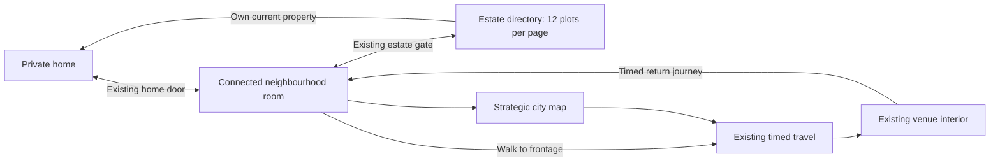

# Phase 5 — connected streets and neighbourhoods

16 October 2026 · baseline `c07bce9` · GH₵0 · local implementation only.

## 1. Original connectivity audit

The [original audit](street-connectivity-audit.md) traced home doors, the `street`
command, estate directories, timed transport, arrival, room presence and reconnect.
Phase 4 provided distinct compositions but each neighbourhood was a single road
scene. Local positions reset on reconnect; the map was the only venue connection.
Local `rx/rz` targets use ±20 room coordinates, while geographic `x/z` determine
fares. Keeping those coordinate systems separate is essential.

Baseline render evidence was captured from an archived, separately built
`c07bce9` client, rather than from the modified working tree. The baseline asset
is `index-BU5iNvfG.js`. Both profiling runs use the isolated local QA database.
Initial baseline attempts failed under local database/session timeouts; the
successful archived-baseline capture occurred after working-tree edits began.

## 2. Final connected-world architecture

Each of the eight existing `n:<home>` destinations now contains an authored local
street graph. Its roads, intersections, sidewalks, entrances and collision remain
available throughout exploration. Four nearby segments carry detailed scenery.
The existing room and its remote avatars remain alive while those details change.

Interiors and estates remain distinct scenes. No engine, backend, shard capacity,
destination catalogue or persistence architecture was replaced. Docker now copies
the small shared street module into both build/runtime paths.

## 3. Street graph and segment design

`shared/local-streets.js` defines versioned intersection nodes, segment endpoints,
widths, adjacency, labels, deterministic frontage placement, entrances, safe
arrival points and solid footprints. It contains no copied city road database.
Each local plan fits in a 40 × 40 room; those dimensions condense neighbourhood
character, rather than representing surveyed block distances.

Lots are kept outside road corridors and the community court, with clear door
approaches. Shared oriented footprint checks prevent rotated buildings from
blocking their own entrance. The navigation grid remains the existing 0.25-unit
grid. Its oriented obstacle rasterization now also catches thin walls.

The Osu pilot connects its Oxford approach, two side loops and residential court
without a room transition. Other district identities have different topology,
widths and frontage composition, rather than one repeatedly reskinned graph.

[View all eight street graph plans](images/streets/network-plans.svg), shown in
authored room coordinates with home, venue, estate and map approaches.

## 4. Eight-neighbourhood coverage

| Existing ID | Intersections / segments / lots | Local composition | Existing ordinary venue links |
| --- | --- | --- | --- |
| `n:nima` | 9 / 10 / 8 | Narrow compound loops and local trade | `mosque`, `viewing` |
| `n:jtown` | 9 / 10 / 6 | Coastal lanes and offset fishing court | `lighthouse`, `kenkey` |
| `n:kaneshie` | 9 / 9 / 5 | Wider commercial hub and transport approaches | None in the existing local catalogue |
| `n:labadi` | 8 / 10 / 5 | Coastal residential loop with cross links | `labadi` |
| `n:osu` | 9 / 10 / 6 | Oxford spine, east/west loops; connected pilot | `oxford`, `restaurant` |
| `n:airres` | 8 / 9 / 7 | Planted residential crescent and airport approach | `airport` |
| `n:legon` | 7 / 8 / 5 | Asymmetric residential and commercial courts | `gymlegon` |
| `n:trasacco` | 9 / 10 / 5 | Formal boulevard and landscaped courts | None in the existing local catalogue |

All eight retain provisions, barber, food, viewing-centre, vendor and community
actions from Phase 4. Their existing opening/schedule rules remain. Kaneshie and
Trasacco use the map for ordinary catalogue venues; no artificial destination
was added to fill that gap. All 55 destination IDs and eight home IDs survive.

## 5. Home and estate connections

Leaving home places the player at that area's residential entrance. The shared
street frontage represents a door approach, not an invented occupied property.
Only the resident receives its “Go indoors” action. Its item index is identical
for other players, preventing furniture-target mismatch in room synchronization.

Walking to the estate gate enters the existing estate scene just inside the gate.
Purchased homes still come from the server directory, in pages of twelve.
An owned current home has a walk-to-door “Go indoors” action. Other owned homes
retain the existing move-in action; private visits retain acquaintance/online
checks. Renters can return through the street entrance. No housing price, rental
rule, inventory or ownership record changes.

## 6. Venue entrances

Nine ordinary destination frontages are linked across six local areas. The player
walks to the relevant doorway, then sees the existing travel chooser with walking
selected when its distance limit allows. The actual journey still takes the
server's quoted time. Other transport choices remain available.

The server remembers an optional street-return context when travelling from a
supported frontage. A venue doormat offers the matching return journey, including
after reload. Returning also uses timed travel and arrives at the correct street
frontage. The visible local facade is a condensed wayfinding connection; its
geographic destination and fare coordinates are unchanged.

## 7. Camera and movement compatibility

The same joystick, canvas tap, pathfinding, speed values and manual pan/zoom are
used. Street taps and joystick targets resolve to valid navigation cells before
being sent. Walking follows the player; street entry frames the actual arrival
point rather than starting an unrelated random entry walk. Interiors retain
their existing framing and movement.

The Phase 2 HUD gains one restrained street-name row and an entrance button only
when a route is nearby. It opens the existing contextual sheet. Online status and
player count remain visible. No second navigation interface or tutorial is added.

Doorway arrivals face the facade from outside, keeping the player in front of
the roof. Interior/estate views restore their usual camera angle. The final
frontage capture verifies this refinement.

Viewport evidence covers 375×812, 390×844, 430×932, 390×530 and 844×390. Layout
checks require the joystick above navigation, below the header, inside the screen
and without horizontal document overflow. Manual pan and wheel zoom are checked.

## 8. Server authority and travel economy

`Game.goPlace`, travel, custody, fare payment, journey timing, arrival and housing
permission checks remain authoritative. Local movement never changes geographic
`p.x/p.z`. The existing free `street` command still permits only the established
home/neighbourhood/estate relationships; it cannot enter ordinary venues, private
visits or unrelated districts.

The server rejects off-network or solid-lot neighbourhood targets and sends an
optional position correction. Valid local targets are saved through the existing
dirty-save lifecycle. Optional `localWalk` and `streetReturn` fields default safely
for older or malformed saves. No migration or birth/economy rebalance is needed.

Local movement packets remain target synchronization, not a new authoritative
physics/speed simulation. Door proximity is an interaction/navigation constraint;
the existing server permission contract remains the security boundary. Full
movement/transport refinement remains a separate Phase 6 task.

## 9. Multiplayer behavior

Segment changes preserve the same `n:<id>#<instance>` room, capacity and presence
rules. Players in that instance see each other's movement. Home entry moves to
the private room; venue travel leaves presence until arrival; stale avatars are
removed by the existing leave messages. No visibility is fabricated across rooms.

Room messages optionally include a validated local entry point and return context.
Reconnect restores a safe authoritative room position. The saved value is the
last accepted target, so it may be slightly ahead of the final visible footstep.
Estates restore the safe entrance/court instead of saving an arbitrary position
among changing owner plots; a later purchase or directory page cannot place a
reconnecting player inside a newly occupied house.

## 10. Streaming and resource ownership

The complete compact road network uses one original 1024² generated texture on
a single plane. Painting the road/sidewalk union eliminates coplanar intersection
seams and uses two resident surface triangles. Alpha-tested empty regions leave
the Phase 4 ground visible. Door paving and cheap building silhouettes remain.

Four nearest/adjacent segments load signs, planting and detailed frontages. New
details are prepared before old details are released; transient allocation can
therefore exceed four during a swap, while the retained active set is four.
Unchanged segment sets do not rebuild. Navigation and entrance indices persist
when their detailed building meshes are absent.

Detailed buildings and segment groups use Phase 4 reference-counted environment
resource scopes and bounded template caches. Removing them cannot dispose another
live avatar's resources. Room disposal releases stream scopes and unique geometry.
A two-entry, reference-counted surface cache reuses road materials/textures between
visits instead of repeatedly uploading and compiling them. Idle entries are
evicted; live scenes remain protected. Two 1024² RGBA road textures use about
8 MiB before mipmaps. Detailed metropolitan geometry is not loaded per street.

## 11. Before/after performance

Performance results are recorded separately from live gameplay. Four visits per
critical scene separate build time, first render and 120 warmed frame samples.
Chromium uses SwiftShader, a 390×844 viewport and 0.7 pixel ratio. The map is
disposed and the socket explicitly closed after authenticated bootstrap to
isolate synthetic renderer measurements. These are not live network timings or
physical-phone FPS.

| Scene | Warm median / p95 before (ms) | Warm median / p95 after (ms) | Draw calls before → after | Triangles before → after | GPU geometries / textures before → after |
| --- | ---: | ---: | ---: | ---: | ---: |
| `makola` | 47.7 / 196.3 | 11.7 / 154.7 | 87 → 87 | 166,922 → 166,922 | 77 / 27 → 77 / 27 |
| `vibes` | 21.2 / 769.7 | 47.4 / 271.5 | 98 → 98 | 136,286 → 136,286 | 106 / 37 → 106 / 37 |
| `n:jtown` | 32.7 / 328.6 | 14.4 / 611 | 49 → 54 | 63,500 → 61,114 | 109 / 41 → 114 / 42 |
| `home:legon` | 34.5 / 435.7 | 20.8 / 385.2 | 114 → 114 | 56,968 → 56,968 | 158 / 56 → 158 / 57 |

| Scene | Build median / maximum before → after (ms) | First render median / maximum before → after (ms) |
| --- | ---: | ---: |
| `makola` | 2103.7 / 12825.4 → 855.0 / 2157.9 | 2146.2 / 10580 → 7880.4 / 17288.1 |
| `vibes` | 2388.9 / 30969.3 → 4874.1 / 31786.8 | 390.8 / 736.2 → 692.4 / 1122.7 |
| `n:jtown` | 1064.2 / 3440.8 → 929.0 / 27211.3 | 105.3 / 316.2 → 162.2 / 247.2 |
| `home:legon` | 2704.0 / 3320.5 → 3287.0 / 11864.6 | 976.8 / 19015.4 → 230.4 / 6652.6 |

P95 uses the nearest-rank method. Raw samples, build identifiers, visit resource counts and authenticated results are in [street-metrics.json](street-metrics.json). GPU counts include retained bounded caches; they are not memory-byte measurements.

An initial Phase 5 capture exposed repeated road-surface creation and cold setup. The final two-entry surface cache reuses those materials and textures. Each repeated Jamestown visit retains: 114 geometries/42 textures/17 programs, 114 geometries/42 textures/17 programs, 114 geometries/42 textures/17 programs, 114 geometries/42 textures/17 programs.

Makola, Vibes and the East Legon interior keep their Phase 4 art. The scoped
changes address street detail allocation, intersection overlap and collision,
not an unrelated interior redesign. Cold compilation, host contention and small
sample counts make desktop timing differences diagnostic, not a performance
guarantee. Vibes' warmed median and Jamestown's warmed tail are worse in this
run; cold maxima also remain substantial. The figures do not establish a uniform
speed improvement. Existing procedural travel-scene construction also stalled
this software-render host; travel receipts were observed before that expensive
UI work when testing disconnection timing. The recorded render build is `index-2uZUMaSM.js`; a subsequent doorway camera
refinement is verified in the final authenticated captures (`index-axmn2DuH.js`).
Court-spawn profiling views and geometry are unchanged. Physical low-end phone 30 FPS and
travel-start latency remain unverified.

## 12. Automated and authenticated browser tests

Client: **44/44 passed**. Server: **49/49 passed**. Production build passed.
New tests cover eight graph topologies, adjacency/reachability, safe approaches,
solid footprints, thin-wall navigation, bounded detail, repeated swaps, stable
item indices, unique surface disposal, valid/corrupt saves, authority, custody,
unchanged fares, timed venue returns and room presence transitions.
An authenticated transition exposed a stale client travel flag between the
arrival room packet and the next periodic state packet. Arrival now clears that
obsolete flag immediately, with a regression ensuring other activities survive.

All eight disposable, production-cookie accounts completed home → street →
joystick intersection → estate → home, with unchanged balances. Four rented
tiers have no fabricated owned house; four purchased tiers enter their actual
owned current property. No user's existing saved game was used for these tests.

| Journey | Authenticated result |
| --- | --- |
| A: home/street/intersection/estate/home | All eight passed; balances unchanged; four purchased current-property doors and four rented-tier routes checked. |
| B: frontage/venue/return | Osu → Oxford → Osu; server-confirmed walking takes 8 seconds each way, GH₵0 as before; correct frontage return. |
| C: distant travel | Osu streets → map → Trotro → Circle; quoted GH₵11 / 27 seconds, debited exactly once; reload during travel and ride cleanup passed. |
| D: multiplayer | Two Osu players; remote joystick movement, click-player Wave, city chat, home leave/rejoin and visible online count passed. |
| E: recovery | Street target restored from (11.882, −7.605) to (11.88, −7.62); venue reload preserved return context. Socket closed while the server journey was active; reconnect arrived in Osu. |
| Estate reload | Actual owner approach → reload → safe gate; own-property re-entry passed. [Capture](images/streets/gameplay/estate-recovery.jpg). |
| Final cached-surface smoke | Own home → street, nearby entrance button, joystick, shader/console checks and real room build timing passed. |

Final authoritative room-packet handling (including World/Room build and HUD refresh): `home` 278.8 ms, `n:osu` 476.1 ms. These exclude walking-to-door time and GPU first render, measured separately above.

Browser render sampling is reduced on this software renderer to leave simulation
and sockets responsive. It is functional verification, not a phone benchmark.
Local test setup experienced intermittent PostgreSQL connection timeouts under
host load; failures were investigated without disabling authentication or server
checks. Only successful completed runs are listed as passing evidence.
The developer server serves the client and shared street module (HTTP 200),
while a HEAD request to a root secret path is refused (403); no secret content
was read. Python helper syntax and whitespace checks also pass.

Reproduce unit checks and the build using `npm test` in each of `client` and
`server`, then `npm run build` in `client`. Browser helpers are
`tools/street-gameplay-test.py` (`--case coverage`, `pilot`, `final`, `estate`)
and `tools/street-performance-test.py` (`--label before` or `after`). Use only
the isolated loopback QA stack and freshly created accounts from the guarded
`server/loadtest/street-fixtures.js`; keep their cookie file under ignored
`.local/phase5/`. Do not run these fixture operations against existing user data.

## 13. Screenshot and route evidence

| Local area | Renderer comparison | Actual estate visit |
| --- | --- | --- |
| Nima | [Before](images/streets/before/n-nima.jpg) · [Final](images/streets/after/n-nima.jpg) | [Estate](images/streets/gameplay/nima-estate.jpg) |
| Jamestown | [Before](images/streets/before/n-jtown.jpg) · [Final](images/streets/after/n-jtown.jpg) | [Estate](images/streets/gameplay/jtown-estate.jpg) |
| Kaneshie | [Before](images/streets/before/n-kaneshie.jpg) · [Final](images/streets/after/n-kaneshie.jpg) | [Estate](images/streets/gameplay/kaneshie-estate.jpg) |
| Labadi | [Before](images/streets/before/n-labadi.jpg) · [Final](images/streets/after/n-labadi.jpg) | [Estate](images/streets/gameplay/labadi-estate.jpg) |
| Osu | [Before](images/streets/before/n-osu.jpg) · [Final](images/streets/after/n-osu.jpg) | [Estate](images/streets/gameplay/osu-estate.jpg) |
| Airport Residential | [Before](images/streets/before/n-airres.jpg) · [Final](images/streets/after/n-airres.jpg) | [Estate](images/streets/gameplay/airres-estate.jpg) |
| East Legon | [Before](images/streets/before/n-legon.jpg) · [Final](images/streets/after/n-legon.jpg) | [Estate](images/streets/gameplay/legon-estate.jpg) |
| Trasacco | [Before](images/streets/before/n-trasacco.jpg) · [Final](images/streets/after/n-trasacco.jpg) | [Estate](images/streets/gameplay/trasacco-estate.jpg) |

Final renderer galleries: [first four areas](images/streets/neighbourhoods-1.jpg) · [other four](images/streets/neighbourhoods-2.jpg).

Actual Osu route: [step 1](images/streets/gameplay/osu-route-1.jpg) → [step 2](images/streets/gameplay/osu-route-2.jpg) → [step 3](images/streets/gameplay/osu-route-3.jpg) → [step 4](images/streets/gameplay/osu-route-4.jpg) → [step 5](images/streets/gameplay/osu-route-5.jpg). [45-second movement clip](images/streets/osu-walking-route.webm), sampled on the software renderer during the authenticated pilot. This was recorded before the final doorway-camera and detail-cache refinements; the street graph and server routes are unchanged.

[Final home](images/streets/gameplay/final-owned-home.jpg) · [final frontage and entrance](images/streets/gameplay/final-home-frontage.jpg) · [final intersection](images/streets/gameplay/final-intersection.jpg) · [night](images/streets/gameplay/osu-night.jpg) · [two players](images/streets/gameplay/osu-two-players.jpg) · [travel choices](images/streets/gameplay/osu-venue-travel-choice.jpg) · [Oxford interior](images/streets/gameplay/oxford-interior.jpg) · [reconnected return](images/streets/gameplay/osu-return-entrance.jpg) · [paid Circle arrival](images/streets/gameplay/circle-paid-arrival.jpg).

Layouts: [375×812](images/streets/gameplay/layout-375-812.jpg) · [390×844](images/streets/gameplay/layout-390-844.jpg) · [430×932](images/streets/gameplay/layout-430-932.jpg) · [390×530](images/streets/gameplay/layout-390-530.jpg) · [844×390](images/streets/gameplay/layout-844-390.jpg).

Screenshots labelled synthetic use real game rendering with explicit room input;
their HUD can retain the authenticated account's real location. Gameplay captures
use actual authoritative room transitions. Day/night review images explicitly
set the existing lighting hour; the HUD clock continues to show Accra time.
Only disposable QA players appear. No production chats or account data is included.

## 14. Exact files changed

The [exact delivery manifest](street-files.txt) lists every source, test, documentation and evidence file changed from `c07bce9`. Runtime additions are the shared graph, connected specification, segment stream and server local-position helper. Existing lifecycle, HUD, travel, Docker and developer-server integration receive focused changes; tests and local QA tools cover their boundaries.

Original procedural work and reused asset licences are recorded in
[environment art provenance](../client/public/assets/ENVIRONMENT-ART.md). No paid
service, downloaded art, external recording or new runtime dependency is added.

## 15. Known limitations

These are compact artistic local plans, not surveyed replicas or continuous
street-by-street access to all 68 metropolitan districts. Cross-neighbourhood,
estate and interior boundaries still use existing transitions. The map and timed
transport remain necessary. Building detail can change at segment boundaries;
roads, navigation and low-detail frontage continuity remain resident.

The pilot verifies two local players, not large crowd/load capacity. Existing
capacity instances remain separate. Long-duration physical-phone thermal,
memory and FPS measurements remain outstanding. Character art/animation, new NPC
AI, driving, careers, police mechanics and economy balancing are outside this
phase. No Phase 6 work is started automatically.
Estate directory pages reuse their twelve visual plots, as before; these are
not globally unique, persistent street addresses.

## 16. Changes requiring explicit approval

No public deployment, destructive migration, saved-data incompatibility,
monetization change or architecture migration is included. Those retain the
project's explicit approval requirement. Committing and pushing validated work
to the existing `origin/main` is already authorized. This milestone is local;
CI container startup is a disposable verification stack, not a deployment.
